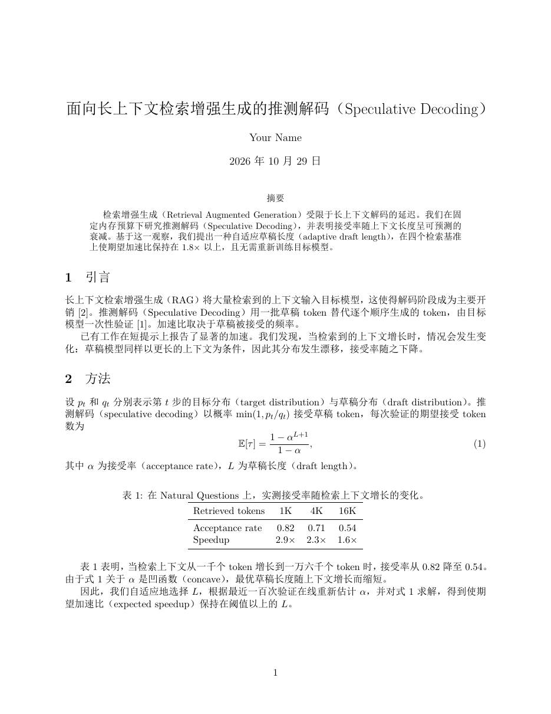
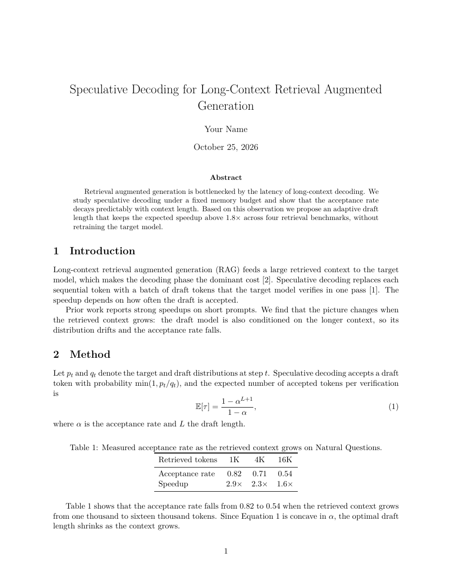

# Paper Mode

[](https://github.com/torfqy/dsh-paper-mode/actions/workflows/ci.yml)
[](LICENSE)

> Overleaf, inside DeepSeek Harness — four parallel panes: LaTeX source, the English typeset PDF, **a Chinese typeset twin of the same paper**, and a paper-aware writing assistant. Double-click either way to jump between them.

 

> Same source, same layout, same equation and citation numbers — the right-hand document is translated at the source level and re-typeset, not machine-translated out of the PDF.

[中文文档](README.md)

## What it does

- **Bilingual output that is really typeset.** The pipeline scans the `.tex`, extracts natural-language runs, replaces math / `\cite` / `\ref` / figures with untranslatable placeholders, translates only the prose, validates that every placeholder and command survived, then splices it back and runs XeLaTeX again. The Chinese PDF is a real second document.
- **Two-way navigation.** Double-click anywhere in a page to jump to the source line (across files, through `\input`). Move the caret and the English pages scroll to it with a highlight box. Real SyncTeX (`-synctex=1`), about 0.05 s of build time.
- **Selectable PDF.** Every page carries an invisible text layer built from `pdftotext -bbox-layout` line boxes, scaled and `scaleX`-fitted to the printed glyphs, so drag-select, double-click-a-word and `Ctrl+C` behave like a real reader. Selections can be sent to the assistant.
- **Compile settings** like Overleaf's: compiler, root document, page resolution, single-pass mode, stop-on-error, bibliography strategy, CJK package, auto-compile delay.
- **Three cache layers.** Recompiling an unchanged document takes 0 ms (build signature hit); translation memory lives in the Harness home so it survives restarts and is shared across papers; page images are keyed by PDF content hash.

## Install

Requirements: DSH ≥ `0.2.1-rc.2`, Node ≥ 22, and a TeX distribution providing `xelatex`, `bibtex`, `pdftoppm`, `pdfinfo`, `pdftotext`, `synctex` (MiKTeX / TeX Live / MacTeX). Chinese fonts come from the OS; on a machine with none, the build falls back to TeX's bundled Fandol fonts.

```bash
git clone https://github.com/torfqy/dsh-paper-mode.git
```

Install the bundle `dsh-paper-mode/paper-mode` from the DSH plugin manager (local directory), or:

```bash
dsh plugin --profile web add link:~/dsh-paper-mode/paper-mode
```

Refresh the page; a **Paper** icon appears in the sidebar.

## Use

| Action | Effect |
|---|---|
| Pause typing | Autosave + rebuild after 1.4 s |
| `Ctrl+Enter` | Build now |
| `Ctrl+S` | Save |
| Double-click a page | Jump to that source line |
| Move the caret | The English pages follow (toggleable) |
| Select PDF text | Sent to the assistant with your next message |

Override the model with `PAPER_MODE_MODEL=provider/model`.

## Design

See [docs/design.md](docs/design.md) (Chinese) for the trade-offs, data flow, cache keys and known limits.

## Development

```bash
node --test paper-mode/test/tex.test.mjs          # dependency-free unit tests
cd paper-mode/test && npm install && node mount.test.mjs   # jsdom mount test
```

The plugin package has no runtime dependencies — the Harness serves it as plain JavaScript.

## License

[MIT](LICENSE)
